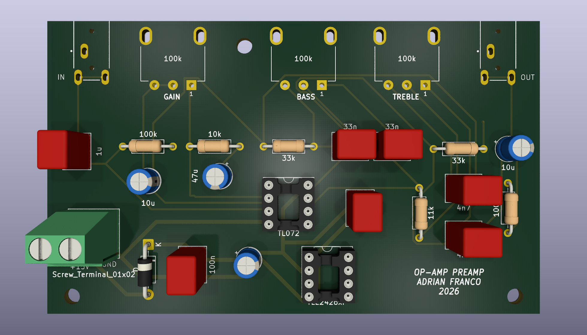
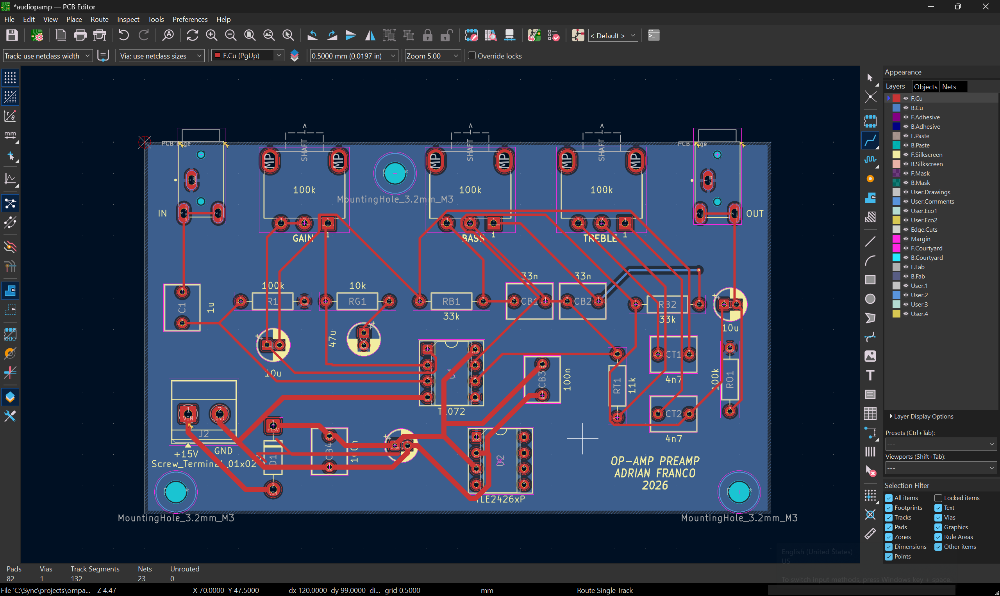

# Op-Amp Preamp

Single-channel audio preamp with gain, bass and treble controls, built around a TL072. I simulated it in PSpice, built it on a breadboard, then laid out a PCB in KiCad and measured both.

A phone or laptop plugs into the input and the output goes to a powered speaker. The gain knob turns the signal up to about 10x, and the bass and treble knobs boost or cut by about 12 dB.

## Demo video

https://github.com/user-attachments/assets/7785a830-bcad-4880-86f1-33a1208d45af

https://github.com/user-attachments/assets/1d51f3fe-2df7-4398-9d68-10ba9ee7a141

Labeled Circuit: 

## Specs

|                                                 | Target     | Calculated       | Breadboard (meter) | PCB (meter)      | PCB (scope)              |
| ----------------------------------------------- | ---------- | ---------------- | ------------------ | ---------------- | ------------------------ |
| Gain                                            | 0 to 20 dB | 0 to 20.8 dB*    | 0 to 21.4 dB       | 0 to 19.7 dB     | 0 to 19.6 dB             |
| Flat response (both tone pots centered, 400 Hz) | ±1 dB      | 0 dB             | +0.6 dB            | −0.3 dB          | 0 dB                     |
| Bass at 50 Hz                                   | ±12 dB     | +8.2 / −8.2 dB   | +8.3 / −8.5 dB     | +8.1 / −8.3 dB   | +8.3 / −8.1 dB           |
| Treble at 10 kHz                                | ±12 dB     | +11.2 / −11.2 dB | +11.8 / −12.5 dB   | +12.2 / −12.4 dB | +11.4 / cut failed (pot) |
| Virtual ground                                  | 7.5 V      | 7.5 V            | 7.48 V             | 7.38 V        | —                        |

## Circuit

The first half of the TL072 is a non-inverting amp. RG is 10k and RF is a 100k pot, so the gain goes from 1 (0 dB) to 11 (20.8 dB). CG (47µF) in series with RG keeps the DC gain at 1 so the output offset stays small.

The second half is a Baxandall tone control. A lot of published versions use 10k resistors around the pots, which gives around ±20 dB. I used 33k so the gain at the ends of the pot is (100k + 33k) / 33k ≈ 4, which is 12 dB.

- Bass: RB = 33k, CB = 33nF (turnover target 50 Hz), 100k linear pot
- Treble: RT = 11k, CT = 4.7nF (turnover target 3 kHz), 100k linear pot

It runs on a single 15 V supply. The TLE2426 makes a 7.5 V virtual ground so the op amps can swing both ways around it.

Hand calculations: [measure/HandCalcs.pdf](measure/HandCalcs.pdf)

Full circuit simulation: [FullCircuitsim/](FullCircuitsim/)

## PCB
After verifying everything on the breadboard, I designed a two layer board in KiCad. Every part is through-hole and designed for hand soldering. The pots and audio jacks mount directly to the board.

Schematic: [docs/PrintUSchematic.pdf](docs/PrintUSchematic.pdf)

### Board
| Item | Value |
|---|---|
| Size | about 100 × 60 mm |
| Layers | 2 (signals on top, VGround on bottom) |
| Parts | through-hole, TL072 and TLE2426 in DIP-8 sockets |
| Power input | 2 pin screw terminal, 15 V, with a series diode  |
| Decoupling | 100 µF + 100 nF at the supply input, 100 nF next to the TL072 |
| Traces | 0.4 mm signal, 0.8 mm power |
| Mounting | M3 holes for standoffs |
## PCB measurements

### Gain stage (400 Hz)

| Gain pot | In (V) | Out (V) | Gain  | dB   | Scope (dB) | Calculated (dB) |
| -------- | ------ | ------- | ----- | ---- | ---------- | --------------- |
| Min      | 0.097  | 0.096   | 0.99x | −0.1 | −0.1       | 0               |
| Half     | 0.097  | 0.541   | 5.6x  | 14.9 | 14.7       | 14.5            |
| Max      | 0.097  | 0.941   | 9.7x  | 19.7 | 19.6       | 19.7            |
 
### Tone stage
 
Bass at 50 Hz:
 
| Bass pot   | In (V) | Out (V) | Gain  | dB   | Scope (dB) |
| ---------- | ------ | ------- | ----- | ---- | ---------- |
| Full cut   | 0.119  | 0.046   | 0.39x | −8.3 | −8.1       |
| Center     | 0.119  | 0.120   | 1.01x | +0.1 | +0.1       |
| Full boost | 0.119  | 0.304   | 2.55x | +8.1 | +8.3       |
 
Treble at 10 kHz:
 
| Treble pot | In (V) | Out (V) | Gain  | dB    | Scope (dB)        |
| ---------- | ------ | ------- | ----- | ----- | ----------------- |
| Full cut   | 0.096  | 0.023   | 0.24x | −12.4 | failed (worn pot) |
| Center     | 0.096  | 0.094   | 0.98x | −0.2  | +0.2              |
| Full boost | 0.096  | 0.393   | 4.09x | +12.2 | +11.4             |
 

### Files
- Oscilloscope captures: [`measure/scope`](measure/scope)
- KiCad project: [`kicad/`](kicad/) 
- Gerbers: [`kicad/audiopamp/gerber.zip`](kicad/audiopamp/gerber.zip)

 
## Breadboard measurements

All readings were taken with a multimeter on AC volts, black probe on the virtual ground, using sine tones from a laptop.

### Gain stage (400 Hz)

Gain stage demo: 

https://github.com/user-attachments/assets/f91d0bfd-d7b4-4a68-a31d-0bf0310b4c41

| Gain pot | In (V) | Out (V) | Gain | dB | PSpice (dB) |
|---|---|---|---|---|---|
| Min | 0.014 | 0.014 | 1.0x | 0 | 0 |
| Half | 0.014 | 0.095 | 6.8x | 16.6 | 15.6 |
| Max | 0.014 | 0.165 | 11.8x | 21.4 | 20.8 |

The input was only 14 mV, which limits the meter to about ±7%, so these are within the meter's accuracy.

### Tone stage

Gain is the tone stage output (pin 7) divided by its input.

Bass at 50 Hz:

| Bass pot | In (V) | Out (V) | Gain | dB |
|---|---|---|---|---|
| Full cut | 0.254 | 0.096 | 0.38x | −8.5 |
| Center | 0.254 | 0.245 | 0.96x | −0.3 |
| Full boost | 0.254 | 0.657 | 2.59x | +8.3 |

Treble at 10 kHz:

| Treble pot | In (V) | Out (V) | Gain | dB |
|---|---|---|---|---|
| Full cut | 0.126 | 0.030 | 0.24x | −12.5 |
| Center | 0.126 | 0.127 | 1.01x | +0.1 |
| Full boost | 0.126 | 0.491 | 3.90x | +11.8 |

At 1 kHz the bass knob does nothing (within 0.1 dB) and the treble knob moves the level by about ±1.8 dB, since the treble shelf starts around 3 kHz.

## Problems I ran into
 
### Breadboard
 
- **60 Hz hum.** Ground loop between the bench supply and the speaker on its wall charger. Gone with the speaker on battery.
- **Channels seemed to swap.** The STX-3000 jack tabs made bad contact in the breadboard. Soldering Dupont leads to the tabs fixed it.
- **"No signal."** Laptop volume was at 10%, so the gain stage output was only 7 mV. At 100% the 50 Hz tone distorted and shrank the bass range, so I measured at about 70%.

### PCB
 
- **Dead TL072.** Both outputs were stuck near the positive rail, the board drew 20 to 36 mA, and the TLE2426 got warm. A new chip fixed it. Now I check DC at every op amp pin before putting audio in.
- **Worn treble pot.** At full cut the 10 kHz output came out about 1.2x the input instead of 0.24x, and there was static below about 40% cut. The joints and traces checked out, so the wiper is losing contact on the worn cut side of the track. I need to replace the 100k Pot.

## Equations

Non-inverting gain:

$$\frac{V_o}{V_i} = 1 + \frac{R_F}{R_G}$$

Gain in dB:

$$A_V[\text{dB}] = 20\log\left(\frac{V_o}{V_i}\right)$$

Filter frequency:

$$f = \frac{1}{2\pi RC}$$

## Software

PSpice, KiCad

## Resources

Rod Elliott's site [sound-au.com](https://sound-au.com/index.html) explained most of what I needed for this project.

[Learn About Electronics: Baxandall tone control](https://learnabout-electronics.org/Amplifiers/amplifiers42.php) explains how the bass and treble controls work and what the response looks like.

[This video](https://www.youtube.com/watch?v=f8DllUXnWA0) helped me see which path each frequency takes through the tone circuit.
