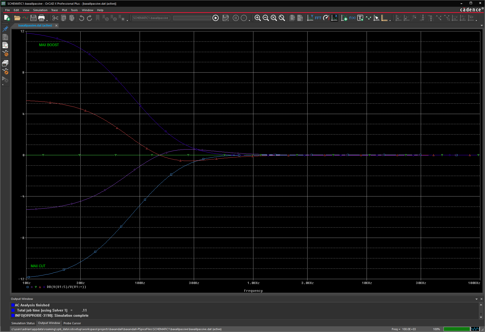
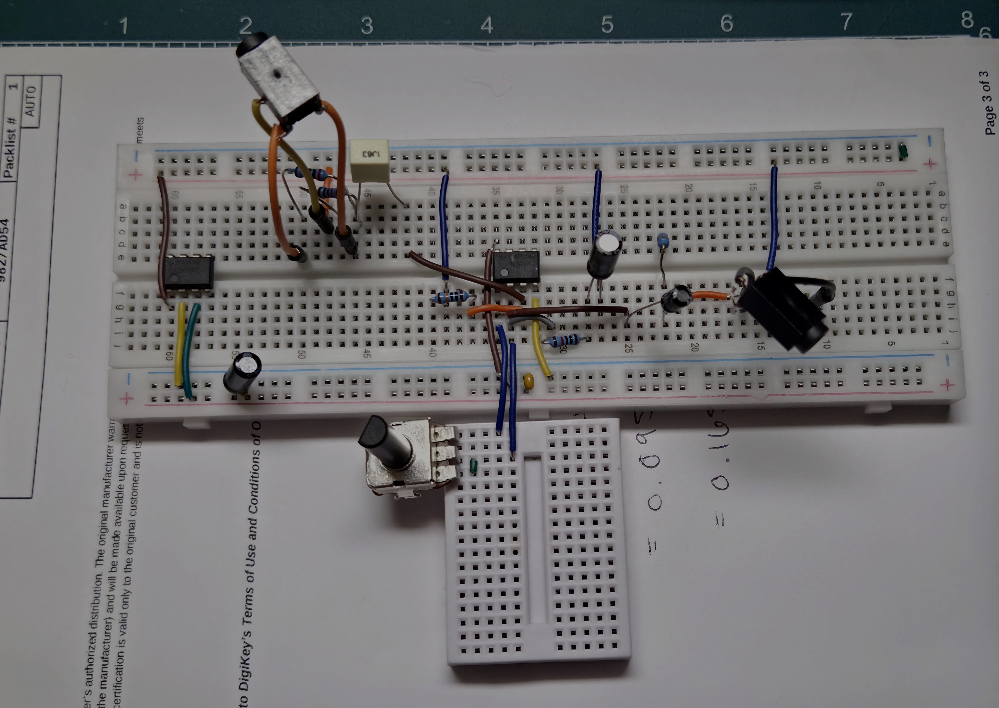

# Op-Amp Preamp

Single-channel audio preamp with gain, bass and treble controls, built around a TL072. I simulated it in PSpice, built it on a breadboard and measured it against my hand calculations. The PCB in KiCad is next.

A phone or laptop plugs into the input and the output goes to a powered speaker. The gain knob turns the signal up to about 11x, and the bass and treble knobs boost or cut by about 12 dB.

## Demo video

https://github.com/user-attachments/assets/7785a830-bcad-4880-86f1-33a1208d45af

Labeled Circuit: 

## Specs

| | Target | Calculated | Measured (breadboard) |
|---|---|---|---|
| Gain | 0 to 20 dB | 0 to 20.8 dB | 0 to 21.4 dB |
| Flat response (both tone pots centered, 400 Hz) | ±1 dB | 0 dB | +0.6 dB |
| Bass at 50 Hz | ±12 dB | +8.2 / −8.2 dB | +8.3 / −8.5 dB |
| Treble at 10 kHz | ±12 dB | +11.2 / −11.2 dB | +11.8 / −12.5 dB |
| Virtual ground | 7.5 V | 7.5 V | 7.48 V |

The bass control only reaches about ±8 dB at 50 Hz because the shelf isn't fully developed there yet (CB is about 97k at 50 Hz, close to the pot value). It reaches ±12 dB further down. The calculated numbers came from a nodal analysis of the full tone network using the measured 87k bass pot, and that analysis predicted the ±8 dB too.

## Circuit

The first half of the TL072 is a non-inverting amp. RG is 10k and RF is a 100k pot, so the gain goes from 1 (0 dB) to 11 (20.8 dB). CG (47µF) in series with RG keeps the DC gain at 1 so the output offset stays small.

The second half is a Baxandall tone control. A lot of published versions use 10k resistors around the pots, which gives around ±20 dB. I used 33k so the gain at the ends of the pot is (100k + 33k) / 33k ≈ 4, which is 12 dB.

- Bass: RB = 33k, CB = 33nF (turnover target 50 Hz), 100k linear pot
- Treble: RT = 11k, CT = 4.7nF (turnover target 3 kHz), 100k linear pot

It runs on a single 15 V supply. The TLE2426 makes a 7.5 V virtual ground so the op amps can swing both ways around it.

Hand calculations: [measure/HandCalcs.pdf](measure/HandCalcs.pdf)
Full circuit simulation: [FullCircuitsim/](FullCircuitsim/)

## Breadboard measurements

All readings were taken with a multimeter on AC volts, black probe on the virtual ground, using sine tones from a laptop.

### Gain stage (400 Hz)

Gain stage demo: 

https://github.com/user-attachments/assets/4122d86a-5e63-4376-95ca-5aafc3da9cc8

| Gain pot | In (V) | Out (V) | Gain | dB | PSpice (dB) |
|---|---|---|---|---|---|
| Min | 0.014 | 0.014 | 1.0x | 0 | 0 |
| Half | 0.014 | 0.095 | 6.8x | 16.6 | 15.6 |
| Max | 0.014 | 0.165 | 11.8x | 21.4 | 20.8 |

The input was only 14 mV, which limits the meter to about ±7%, so these are within the meter's accuracy.

### Tone stage

Gain is the tone stage output (pin 7) divided by its input.

Bass at 50 Hz, treble centered:

| Bass pot | In (V) | Out (V) | Gain | dB | Calculated (dB) |
|---|---|---|---|---|---|
| Full cut | 0.254 | 0.096 | 0.38x | −8.5 | −8.2 |
| Center | 0.254 | 0.245 | 0.96x | −0.3 | 0 |
| Full boost | 0.254 | 0.657 | 2.59x | +8.3 | +8.2 |

Treble at 10 kHz, bass centered:

| Treble pot | In (V) | Out (V) | Gain | dB | Calculated (dB) |
|---|---|---|---|---|---|
| Full cut | 0.126 | 0.030 | 0.24x | −12.5 | −11.2 |
| Center | 0.126 | 0.127 | 1.01x | +0.1 | 0 |
| Full boost | 0.126 | 0.491 | 3.90x | +11.8 | +11.2 |

At 1 kHz the bass knob does nothing (within 0.1 dB) and the treble knob moves the level by about ±1.8 dB, since the treble shelf starts around 3 kHz. The calculation predicted ±1.9 dB.

Every tone measurement landed within about 1.3 dB of the calculation, and most within 0.3 dB.

## Problems I ran into

- **60 Hz hum.** Ground loop between the bench supply and the JBL speaker on its wall charger. Gone with the speaker on battery.
- **Channels seemed to swap.** The STX-3000 jack tabs made bad contact in the breadboard. Soldering Dupont leads to the tabs fixed it.
- **"No signal."** Laptop volume was at 10%, so the gain stage output was only 7 mV. At 100% the 50 Hz tone distorted and shrank the bass range, so I measured at about 70%.
- **Tone stage input sagged about 20% at full bass boost.** I ruled out the pot, perfboard leakage, header placement, the coupling cap, CT, and the TL072 itself, and found a leftover 33k test resistor that made it worse. The sag went away with the speaker unplugged, so the cause is a shared ground return between the output and the input/gain stage on the breadboard.

## Equations

Non-inverting gain:

$$\frac{V_o}{V_i} = 1 + \frac{R_F}{R_G}$$

Gain in dB:

$$A_V[\text{dB}] = 20\log\left(\frac{V_o}{V_i}\right)$$

Filter frequency:

$$f = \frac{1}{2\pi RC}$$

## Software

PSpice, KiCad

## Resources

Rod Elliott's site [sound-au.com](https://sound-au.com/index.html) explained most of what I needed for this project.

[Learn About Electronics: Baxandall tone control](https://learnabout-electronics.org/Amplifiers/amplifiers42.php) explains how the bass and treble controls work and what the response looks like with the pots centered.

[This video](https://www.youtube.com/watch?v=f8DllUXnWA0) helped me see which path each frequency takes through the tone circuit.
 
